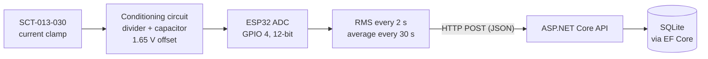

# ⚡ ESP32 Energy Monitor

Non-invasive AC current monitor built with an **ESP32** and an **SCT-013** current clamp. The firmware measures current with a true-RMS calculation, averages it every 30 seconds and reports it over WiFi to an **ASP.NET Core 8** API that stores the readings with **EF Core**.

Undergraduate research project (*Iniciação Científica*) — Computer Engineering, Universidade Veiga de Almeida (UVA).


## How it works



**Measurement pipeline (firmware)**

1. The clamp outputs an AC voltage proportional to the current (SCT-013-030: 1 V = 30 A).
2. A voltage divider and a capacitor shift the signal to a 1.65 V offset, so the whole wave fits in the ESP32's 0–3.3 V ADC range.
3. Each reading takes 500 ADC samples and computes the RMS from the variance — this removes the DC offset mathematically instead of relying on a fixed calibration value.
4. Readings under 30 mV RMS are treated as noise (zero current).
5. Current is converted to apparent power (VA) using the grid voltage (127 V by default).
6. 15 readings (one every 2 s) are averaged and sent as a single record every 30 s.

**Built-in circuit self-test** — on boot, the firmware runs three checks over the serial monitor and prints a diagnosis for each failure (e.g. wrong divider resistor, inverted capacitor, noisy USB supply):

| Test | Checks |
| --- | --- |
| DC offset | The divider midpoint is ~1.65 V (ADC ≈ 2048 ± 250) |
| Noise | Peak-to-peak variation without load is within limits |
| Signal detection | RMS rises when a load runs through the clamp |

**Resilience:** WiFi auto-reconnect, NTP time sync (timestamps in UTC, with a fallback to server time), and 5 s HTTP timeouts so a slow API never blocks the measurement loop.

## Hardware

- ESP32 DOIT DevKit v1
- SCT-013-030 current transformer (30 A / 1 V)
- Two equal resistors (voltage divider from 3.3 V) and a 10 µF capacitor
- Breadboard and jumper wires

## API

ASP.NET Core 8 Minimal API with EF Core + SQLite, packaged with Docker.

| Method | Route | Description |
| --- | --- | --- |
| `POST` | `/api/sensors/save` | Stores a reading sent by the ESP32 |
| `GET` | `/api/sensors/active` | Health/status check |

Example payload sent by the device:

```json
{
  "equipment": "Computador - 800w",
  "current": "2.3150",
  "power": "294.00",
  "location": "Residencia - Sala",
  "unit": "A",
  "timestamp": "2026-08-05T14:30:00Z"
}
```

The API also stores the time the record reached the database, so device and server clocks can be compared.

## Running it

### 1. API

```bash
cd src
docker compose up --build
```

The API listens on `http://localhost:8080` and keeps the SQLite file in a Docker volume. Without Docker: `cd src/API && dotnet run`.

### 2. Firmware

Requires [PlatformIO](https://platformio.org/) (VS Code extension or CLI).

```bash
cd src/esp32-energy-monitor
cp src/secrets_model.h src/secrets.h   # then set WIFI_SSID, WIFI_PASS and API_HOST
pio run --target upload
pio device monitor
```

`secrets.h` is git-ignored — credentials never go to the repository.

## Status and roadmap

- [x] Signal conditioning circuit and boot self-tests
- [x] True-RMS current measurement with noise threshold and 30 s averaging
- [x] WiFi, NTP and HTTP client in the firmware
- [x] API with EF Core + SQLite, containerized
- [ ] Enable WiFi reporting in the main loop and validate end-to-end *(disabled while the circuit is being calibrated)*
- [ ] Calibrate against a known load
- [ ] Store current and power as numeric types instead of strings
- [ ] Read endpoints: history by period and energy consumption (kWh)
- [ ] Dashboard with charts

## Project structure

```
src/
├── esp32-energy-monitor/   # PlatformIO firmware (C++ / Arduino)
│   ├── platformio.ini
│   └── src/
│       ├── main.cpp
│       └── secrets_model.h
├── API/                    # ASP.NET Core 8 API
│   ├── Endpoints/  Services/  Models/  DTOs/  Data/  Migrations/
│   └── Dockerfile
└── docker-compose.yml
```

## Author

**Pedro Arnaldo** — [LinkedIn](https://www.linkedin.com/in/pedro-arnaldo-madeira-lopes/) · [GitHub](https://github.com/PedroArnaldo)
